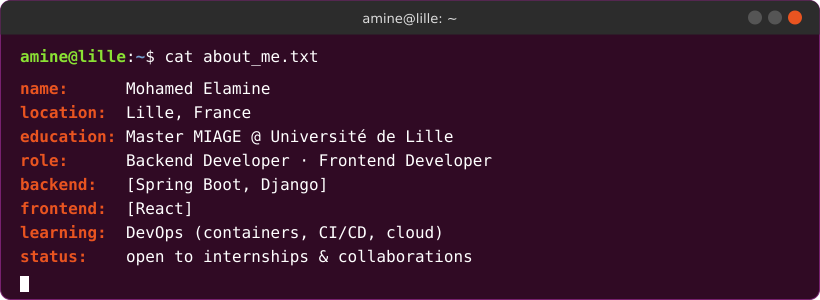

<!-- ===================== HEADER ===================== -->
<p align="center">
  
</p>

---

```bash
amine@lille:~$ cat about_me.txt
```
<p align="center">  </p>

```bash
amine@lille:~$ ls ~/stack
```

<p align="left">
  
  
  
  
  
</p>

```bash
amine@lille:~$ ls ~/databases
```

<p align="left">
  
  
  
</p>

```bash
amine@lille:~$ ls ~/tools
```

<p align="left">
  
  
  
  
  
</p>

```bash
amine@lille:~$ neofetch --github
```

<p align="center">
  
  
</p>

```bash
amine@lille:~$ ./snake.sh
```

<p align="center">
  
</p>

```bash
amine@lille:~$ cat contact.sh
```

<p align="left">
  <a href="https://www.linkedin.com/in/mohamed-elamine-hadj-ali-a87a22268/"></a>
  <a href="mailto:hadjali.mohamed.elamine@gmail.com"></a>
</p>

```bash
amine@lille:~$ ls ~/projects
```
